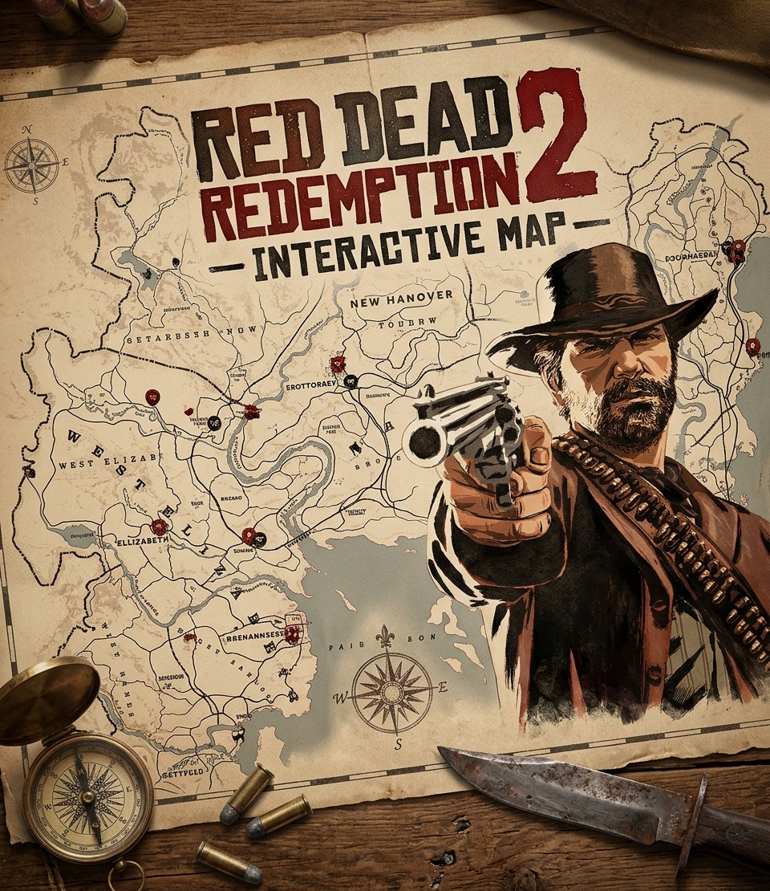
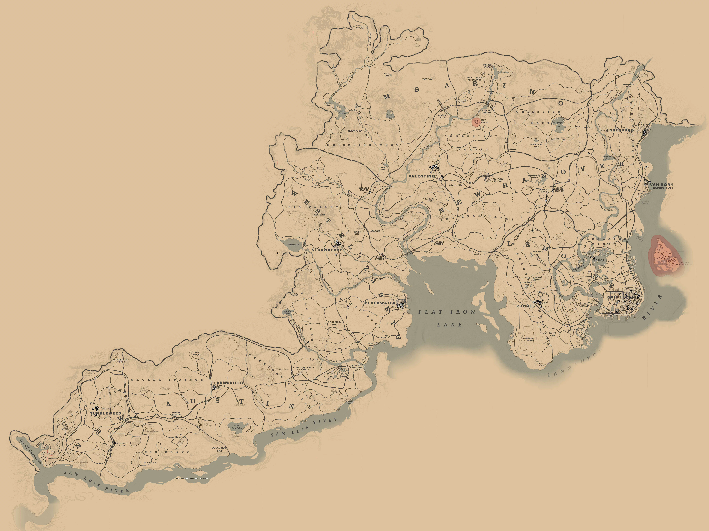

<div align="center">

#  Red Dead Redemption 2 — Interactive Map

<p>
  <b>Um guia visual e interativo completo para desbravar o Velho Oeste.</b>
</p>

<p>
  
  
  
</p>

<br />

<!-- Substitua o link abaixo por uma imagem real do seu projeto -->


</div>

---

## 📌 Sobre o Projeto

Este projeto consiste em um site inspirado no jogo **Red Dead Redemption 2**, desenvolvido para criar um mapa interativo que ajude os jogadores a encontrar conteúdos importantes espalhados pelo vasto mundo do jogo.

A plataforma funciona como um **guia prático de exploração**, reunindo informações essenciais em um único lugar para facilitar a busca de itens, locais e segredos durante a jornada — sendo ideal tanto para iniciantes quanto para quem busca os **100% de conclusão**.

---

## ⚡ Funcionalidades

- 🗺️ **Mapa Interativo:** Visualização do mundo do jogo com marcadores categorizados e detalhados.
- 🐻 **Animais Lendários:** Localização exata para caça e rastreamento da fauna lendária.
- ⚔️ **Armas:** Indicação precisa de onde encontrar diferentes armas e equipamentos raros.
- ⏳ **Missões Perdíveis:** Localização e alertas sobre missões secundárias que podem ser perdidas no decorrer da campanha.
- 🏙️ **Cidades:** Identificação rápida das principais cidades, povoados e localidades de interesse.
- 🔍 **Filtros e Pesquisa:** Ferramentas de busca rápida para encontrar conteúdos específicos sem a necessidade de percorrer todo o mapa manualmente.

---

## 🎨 Identidade Visual

O design foi totalmente inspirado no universo do Velho Oeste, priorizando uma atmosfera imersiva e agradável para a navegação:

| Elemento Visual | Hex Code | Aplicação no Design |
| :--- | :--- | :--- |
| 🤎 **Marrom** | `#3E2723` | Estruturas principais, bordas e detalhes em tom de couro |
| 🌲 **Verde Floresta** | `#1B4D3E` | Elementos de natureza, mapa e destaques |
| 📜 **Bege** | `#F4EAE1` | Fundo de páginas e leitura estilo papel envelhecido |
| 🩸 **Vermelho Escuro** | `#8B0000` | Ícones de destaque, botões e alertas importantes |

---

## 🛠️ Tecnologias Utilizadas

- **HTML5** – Estruturação semântica do site.
- **CSS3** – Estilização temática, layout responsivo e identidade visual.
- **JavaScript** – Interatividade do mapa, marcadores dinâmicos e sistema de pesquisa/filtros.

---

## 📸 Demonstração

<div align="center">
  <!-- Substitua a imagem abaixo por um print do mapa rodando -->
  
</div>

---

## 🚀 Como Executar o Projeto

1. **Clone o repositório:**
   ```bash
   git clone [https://github.com/breno-zanon608/rdr2-interactive-map.git](https://github.com/breno-zanon608/rdr2-interactive-map.git)
